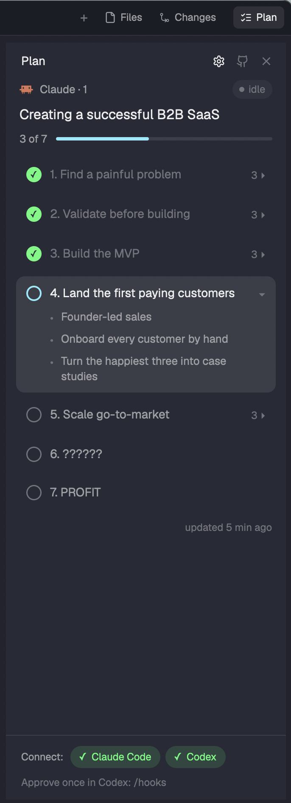

<div align="center">


# Agent Plans for Herdr

**Your coding agent's plan, right beside it.**

[](https://herdr.dev/mods)
[](https://docs.claude.com/en/docs/claude-code)
[](https://developers.openai.com/codex)
[](LICENSE)



</div>

Approve a plan in **Claude Code** plan mode or **Codex** Plan Mode, and its stages show up in a **Plan** panel next to Files and Changes: what's done, what the agent is on now, what each stage contains. Each space keeps its own panel open or closed.

No daemon, no plan files in your repos — two small hooks and a panel.

## How it works

| | Plan comes from | Progress |
| --- | --- | --- |
| **Claude Code** | the plan you approve in plan mode (also `TodoWrite`, `TaskCreate` / `TaskUpdate`) | Claude marks each stage done with `plan.py next` |
| **Codex** | the `<proposed_plan>` of Plan Mode (also `update_plan`) | Codex marks stages with its `update_plan` tool |

The hooks remind the agent how to mark stages, once per plan. Plans are tied to the agent's Herdr terminal, so several agents in one repo never mix up.

## Install

Needs Herdr 0.1.13+, `python3`, and Claude Code and/or Codex.

**1. Add the mod.** Ask the agent running in Herdr:

```text
Read ~/.config/herdr-app/AGENTS.md, then add this mod: https://github.com/dendenlarin/herdr-agent-plans
```

It copies the mod and adds the Plan button: to your own layout if you use one, otherwise as the included `main-plans` layout (Herdr's own layouts are read-only).

<details>
<summary>By hand</summary>

Copy `mods/agent-plans/` to `~/.config/herdr-app/mods/`. Then either use the included layout:

```sh
cp layouts/main-plans.json ~/.config/herdr-app/layouts/
herdr-app do layout.switch '{"name":"main-plans"}'
```

or, in a layout of your own, wrap the `tabs` block in a row with the button:

```json
{ "id": "tab-bar", "type": "row", "size": { "px": 42 }, "resizable": false, "children": [
  { "id": "tabs", "type": "block", "window_drag": true, "content": { "mod": "tabs" } },
  { "id": "plans-button", "type": "block", "size": { "px": 72 }, "window_drag": true,
    "content": { "mod": "agent-plans", "props": { "button": true } } } ] }
```

and add a third child to the `panel-body` stack:

```json
{ "id": "plans", "type": "block", "content": { "mod": "agent-plans" } }
```
</details>

**2. Connect your agents.** Open the Plan panel and click **Claude Code** or **Codex** under *Connect*. That adds the hooks (a backup of the config is kept next to it); click again to remove them. In Codex, approve the new hooks once with `/hooks`. The ⚙ in the panel header brings the buttons back later.

<details>
<summary>What Connect adds</summary>

The same command for every hook; it does nothing if the mod is removed:

```sh
P="${HERDR_APP_HOME:-$HOME/.config/herdr-app}/mods/agent-plans/hook/plan.py"; [ -f "$P" ] && python3 "$P" claude || true   # codex for Codex
```

- `~/.claude/settings.json`: `PostToolUse` (matcher `ExitPlanMode|TodoWrite|TaskCreate|TaskUpdate`), `TaskCreated`, `TaskCompleted`.
- `~/.codex/config.toml`: `Stop`, `UserPromptSubmit`, `PostToolUse` (matcher `^update_plan$`), between `# >>> agent-plans` and `# <<< agent-plans`.

From a terminal: `python3 ~/.config/herdr-app/mods/agent-plans/hook/plan.py connect claude` (or `disconnect`, `status`).
</details>

## What it touches

- **Writes** one file per agent terminal: `~/.config/herdr-app/data/agent-plans/<terminal>.json`. Nothing in your repos.
- **Changes your agent configs** only when you click Connect (see above).
- **Reads** the hook input from Claude Code and Codex, and asks `hc` which terminal a Codex session runs in.
- **Tells the agent**, once per plan, how to mark stages.
- No network, no background process.

## Uninstall

Click the connected agents in the panel to remove the hooks, then delete `mods/agent-plans/`, `data/agent-plans/` and the layout (or its two blocks).

## Good to know

- Only this computer's agents are shown.
- A stage is marked when the agent says so: if it forgets, the panel lags behind.
- Codex runs its hooks in a shared background server, so the hook finds the Codex terminal by its folder and, with several Codex in one folder, by the thread name in the terminal title. If it still can't tell, the plan isn't shown.
- `main-plans` is a copy of Herdr's `main` 0.1.13 and doesn't pick up later changes to `main`.

MIT License
