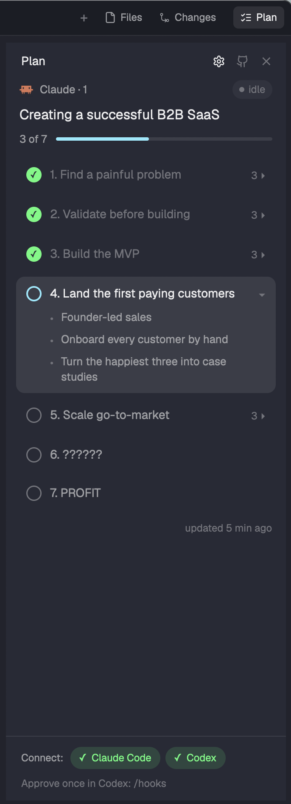

# Agent Plans

The plan your coding agent approved, beside it: a **Plan** button after Files and Changes opens a panel with the plan's stages for the shown space — done, current, still to do — and what each stage contains. Plans come from Claude Code plan mode (`ExitPlanMode`) and Codex Plan Mode (`<proposed_plan>`), through hooks that write one JSON file per terminal.

## What you see

- **Plan button**: a 72px block at the right end of the tab-bar row, `chrome` background with the tab bar's 1px `border` along the bottom. Inside, right-aligned with 10px right padding: a 26px pill, 8px side padding, 5px gap, radius 6, 12px text — a 14px list-check icon (`plan.svg`) and `Plan`. `selected` background and `foreground` text while the Plan panel shows, else `chrome` and `muted`; `hover` on hover. Same look as the tab bar's Files and Changes buttons.
- **Panel**, the third child of the right `panel-body` stack, `background` color, top to bottom:
  - **Text buttons** (Connect, Clear) share the header icons' look: 26px high, 8px side padding, radius 6, no fill, a 14px Lucide icon and 12px `muted` text 6px apart; `hover` behind and `foreground` text on hover. The icon's color carries the state.
  - **Header**, 44px, 18px left / 10px right padding: `Plan` 14px semibold; 26px icon buttons (15px icons, `dim`): ⚙ `settings.svg` (tooltip `Connected agents`, shows the Connect row), GitHub (tooltip `Agent Plans on GitHub`), `✕` (tooltip `Hide panel`).
  - **Agent chips**, only when more than one agent in the tab has a plan, 2px apart: 26px, radius 6, 12px text, the program icon (13px) and the tab name (max 120px, truncated); `selected` behind and `foreground` text for the shown one, no fill and `muted` otherwise, `hover` on hover.
  - **Agent block**, 4px side inset: program icon 16px, `Claude · <tab>` or `Codex · <tab>` in 13px `muted`, a status pill on the right (22px, radius 11, 6px dot, 12px text, the color at 12% as background): `working` (`working`), `needs you` (`blocked`), `done` (`done`), `idle` and `closed` (`dim`), and a 22px trash button (`trash.svg` 13px, `dim`, tooltip `Clear plan`): the first click turns it into `Clear?` (`blocked` on `blocked` at 12%), the second deletes the plan (`plan.py --terminal <key> clear`); it turns back after 3 s. Then the plan title, 16px semibold, line height 1.3, cut at 140 characters. Then `2 of 5` in 12.5px `muted` and a 4px progress bar (`border` track, `working` fill, `done` when all done).
  - **Stage cards**, 6px apart, each radius 10, 12px/10px padding, no border: `raised` for the current stage, `surface` for the rest. A row: an 18px status mark, clickable (`hover` behind it, tooltip `Mark done` / `Mark not done`; runs `plan.py --terminal <key> toggle <n>`, without folding the card) (done: `done` disc with a `✓` in `background`; current: 16px `spinner.svg` spinning every 1100ms in `working` while the agent works, else a 2px `working` ring; pending: 1.5px `dim` ring), the stage name in 14px (current: `foreground`, medium; pending: `muted`; done: `dim`), and on the right `N ▸` (folded) or `▾` (open) in 12px `dim` when the stage has points. An open card lists its points under the name, 28px inset: `•` and the text in 13px, line height 1.4.
  - **Footer**, 12px `dim`: the agent's current activity (its Herdr status message) while it works, and `updated 3 min ago` on the right. When every stage is done, instead: a 36px banner, radius 10, `done` at 12%: `check.svg` 14px and `Plan complete` (12.5px `done`, medium), `3 min ago` (`dim`), and on the right a `trash.svg` `Clear` text button that deletes the plan at once.
  - **Empty**: `No plan in this tab yet.` (`muted`) and `Approve a plan in Claude Code plan mode or Codex Plan Mode, and its stages show up here.` (`dim`).
  - **Connect row**, at the bottom above a 1px `border` line, 18px/10px padding, only while an installed agent (its config folder exists) is not connected or connected by an older version (`outdated`: other hook entries than `connect` writes now), or after the ⚙ header button: `Connect` in 12px `dim`, then a text button per installed agent, `Claude Code` / `Codex`, 2px apart: connected — `check.svg` in `done`; outdated — `refresh.svg` in `working` (a click reconnects); not connected — `plug.svg` in `dim`; while it works, `spinner.svg` spinning in `working`. Lines under it in 12px `dim`: while one is outdated, `New hooks in this version: click ↻ to update.`; while Codex is connected, `Approve once in Codex: /hooks`. If `python3` can't run: `Agent Plans needs python3 on PATH to connect agents.`

## How it behaves

- **Button**: toggles the panel — `layout.select {stack: "panel-body", child: "plans"}` + `layout.show {id: "panel"}`, or `layout.hide {id: "panel"}` when the Plan panel already shows. On start it adds `"plans"` to shared `workspace.panels`, so Herdr's `tabs` mod restores the panel per space.
- **Which plans**: every `data/agent-plans/*.json` whose terminal is in the shown space's active tab (space: `agents()` space, else the terminal's `herdr.space` label; tab: `agents()` tab, else its pane's tab in `panes()`, else the `herdr.tab` label), live or updated in the last 30 minutes. Live means its agent still runs there: the address is in `agents()`, or the live terminal's `agent` equals the plan's `app`; a shell left behind (the agent exited, or the terminal was restored after a reboot under the same address) is not live. Default selection: the one picked with a chip in this tab, else the focused agent's plan, else the newest. A tab without its own plan shows Empty, not another tab's plan.
- **Stages**: exactly one card open per plan — the one clicked, else the current stage. Clicking the open card folds it; clicking another opens it and folds the previous. Cards without points don't react.
- **Agent status**: working shows the spinner on the current stage and the activity line; blocked shows `needs you`; a plan whose agent is gone shows `closed`.
- **Updates**: `watchFolder` on the data folder (created if missing), a 3s re-read as a fallback, a redraw only when the files change, and once a minute for the `updated` time and the hook check.
- **Stage marks, trash, Clear**: run `python3 hook/plan.py --terminal <key> toggle <n>|clear`, then re-read.
- **Connect pills**: run `python3 hook/plan.py connect|disconnect claude|codex` (`connect` when outdated) and redraw from its JSON; the status comes from `plan.py status` at start and every minute.
- **GitHub icon**: opens the repository in the system browser (`open`, `xdg-open` or `cmd /c start`).

## Built from

- **Mod** `mods/agent-plans/`: `mod.json` `{ "place": "none", "title": "Plan" }`; `main.js` (one `View`, two roles: `props().button` → the button, else the panel); `plan.svg`, `github.svg`, `settings.svg`, `trash.svg`, `check.svg`, `plug.svg`, `refresh.svg` (Lucide); `hook/plan.py`.
- **Layout blocks**: the `tabs` block wrapped in a 42px row `tab-bar` (not resizable) with `plans-button` (`{ mod: "agent-plans", props: { button: true } }`, 72px, `window_drag`); `plans` (`{ mod: "agent-plans" }`) as the third child of `panel-body`. `examples/main-plans.json` is Herdr `main` 0.1.13 with both.
- **herdr**: `spaces`, `agents`, `terminals`, `panes`, `focused`, `layout`, `theme`, `shared`/`setShared` (`workspace.panels`), `props`, `run` (`layout.select`, `layout.show`, `layout.hide`), `appHome`, `readTextFile`, `watchFolder`, `exec`, `window`; `fs/promises` `readdir`, `mkdir`. Art from `mods/workspace-chrome/spinner.svg`.
- **Data**: `<app home>/data/agent-plans/<terminal>.json`: `{ app, session, source, title, terminal, updated, reminded?, steps: [{ text, status: "pending"|"in_progress"|"completed", items: [], active? }] }`.
- **Hook script** `hook/plan.py` (Python 3, standard library):
  - `claude`: `PostToolUse` for `ExitPlanMode` (markdown from `tool_input.plan`, else the file at `planFilePath`), `TodoWrite`, `TaskCreate`/`TaskUpdate`; events `TaskCreated`/`TaskCompleted`; `Stop` (see below). After a plan-mode plan it prints `hookSpecificOutput.additionalContext` listing the parsed stages, with `plan.py set …` to replace them if they don't match the plan and `plan.py next` to run after each stage, the last one too.
  - `codex`: `Stop` (the last `<proposed_plan>…</proposed_plan>` in `last_assistant_message`), `UserPromptSubmit` (once per plan, `additionalContext` listing the parsed stages and asking Codex to track them with `update_plan`, or to send the right stages there if they don't match), `PostToolUse` `update_plan` (statuses copied onto the plan's stages when every name matches, else the steps replace the plan).
  - `Stop` (both agents): a plan from plan mode or `set` (same session for Claude) whose only open stage is the last one, `in_progress`, gets it marked `completed`: agents forget the last `next`. Todos, tasks and `update_plan` steps are left alone. A Codex `Stop` without a plan looks the terminal up only while such a Codex plan exists.
  - Markdown (code blocks skipped): title is the first `# `; stages are `## ` headings minus Context/Notes/Risks/Out-of-scope-style sections; when none of them is an explicit stage (`Step|Phase|Stage|Part|Milestone`, their Russian equivalents, or numbered), a section with `### ` subheadings is replaced by them (not the verification section); when any is, only explicit stages plus the verification section stay. A stage's points are its top-level list items, shortened to the bold lead or the first sentence (110 chars). The first stage starts as current.
  - CLI: `next`, `done` (all stages), `mark <n> done|doing|todo`, `toggle <n>` (done ↔ pending; if no stage is current then, the first pending one becomes current), `set --title T "doing:…" "todo:…"`, `show`, `clear` (need `HC_TERMINAL_ID`, or `--terminal <id>` before the command, as the panel does); `status` (per agent `present`, `connected`, `outdated`), `connect|disconnect claude|codex`. Claude hooks without `HC_TERMINAL_ID` do nothing; Codex hooks look the terminal up (see Watch out). Hooks always exit 0. Atomic writes; reads and writes of plans go one at a time under `flock` on `data/agent-plans/.lock` (hooks run in parallel). `next`/`mark` on a plan built from Claude tasks update the tasks too. Each save deletes plans and temp files not updated for 7 days. Tests: `python3 -m unittest discover tests`.
- **Hooks**, written by `plan.py connect` (first change backs the config up as `<config>.bak-agent-plans`; a symlinked config is written through to its target; the Codex config must still parse as TOML or nothing is written; `disconnect` removes exactly these entries — Claude: groups whose command contains `agent-plans/hook/plan.py`; Codex: the block from `# >>> agent-plans (Herdr Agent Plans)` to `# <<< agent-plans`, ending early at the first table that isn't `[[hooks.<event>]]`/`[[hooks.<event>.hooks]]`: Codex rewrites its config and may put `[hooks.state]` or `[mcp_servers.*]` before our end marker, and those stay): `~/.claude/settings.json` and `$CODEX_HOME/config.toml` (default `~/.codex`), the command `P="${HERDR_APP_HOME:-$HOME/.config/herdr-app}/mods/agent-plans/hook/plan.py"; [ -f "$P" ] && python3 "$P" claude || true` (`codex` for Codex). Exact entries in README.md.

## Watch out

- Write `mod.json` (`"place": "none"`) before `main.js`: a new mod folder without it is docked into the shown layout on first sight.
- Installing: Herdr's shipped layouts are read-only. If the shown layout is the person's own, add the two blocks to it; otherwise copy `examples/main-plans.json` and `layout.switch` to it. Don't connect hooks during install: the person does it with the Connect pills.
- `hookSpecificOutput.additionalContext` is what reaches the agent; plain stdout from these hooks is ignored.
- Codex's sandbox blocks writes outside the workspace, so `plan.py next` from Codex fails there unless the data folder is a writable root; Codex is told to use `update_plan` instead, whose hook runs outside the sandbox.
- Codex skips new or changed hooks until they are trusted in `/hooks`.
- Codex hooks usually run in the shared `codex app-server`, not in the terminal, so `HC_TERMINAL_ID` is missing. The hook then asks `hc` for live `codex` terminals on this machine whose foreground folder is the session's `cwd`: one → that one; several → the one whose title (`<spinner> <thread name> | <project>`) matches the thread name from `<CODEX_HOME>/session_index.jsonl` (CODEX_HOME from `transcript_path`); still several → the only one `working`; else nothing is written.
- An approved Codex plan starts a new thread whose first message begins `A previous agent produced the plan below` and holds the whole plan: `UserPromptSubmit` takes the plan from there. Codex plans are keyed by terminal, not session, since the thread id changes.
- Recent Codex versions rarely call `update_plan` on their own; Plan Mode's `<proposed_plan>` is the reliable source.
- Don't redraw on the 3s timer: every mod redraw redraws the window.
- This computer only (`watchFolder` and file reads are local).

## Done when

- `herdr-app check ~/.config/herdr-app/mods/agent-plans` passes and `herdr-app status` lists no errors.
- The Plan button sits after Changes; clicking it shows the panel, clicking again hides it; in another space the panel keeps that space's own state.
- Approving a plan in Claude Code plan mode in a Herdr terminal creates `data/agent-plans/<terminal>.json` and the panel shows its stages, the first one current; `python3 …/plan.py next` in that terminal advances it.
- A Codex Plan Mode plan in a Herdr terminal shows up once it is approved, also with the Codex app-server running the hooks; its `update_plan` calls move the stages.
- With two agents' plans in one space, chips switch between them.
- Only one stage card is open at a time.
- Clicking a Connect pill adds the hooks (the config parses afterwards), clicking it again restores the config's previous entries.
- With the mod folder removed, Claude Code and Codex run without hook errors.
